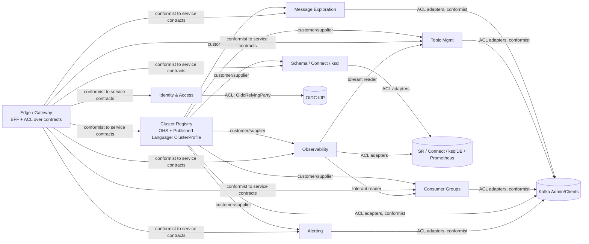
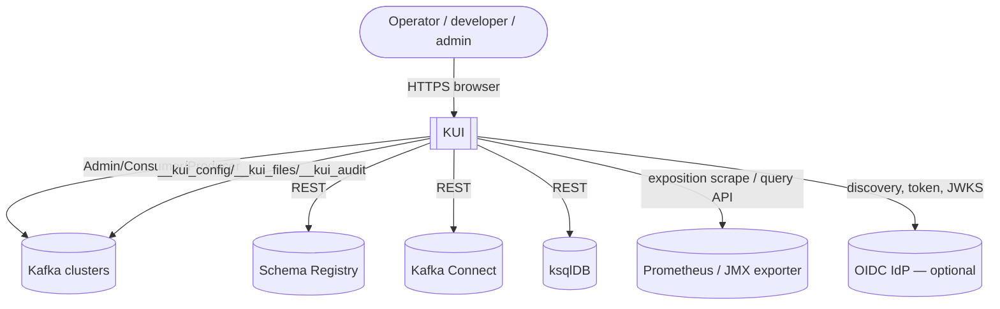
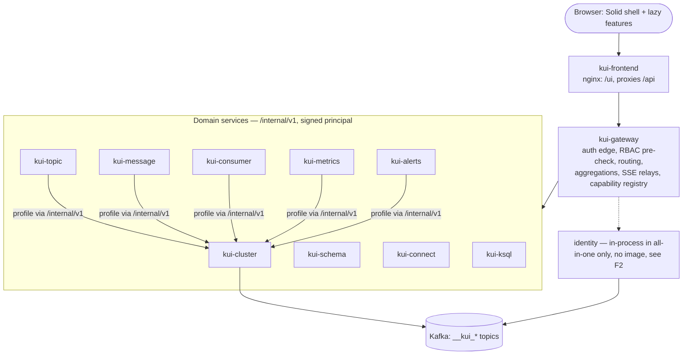
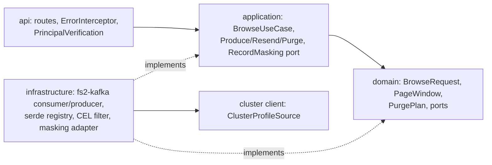
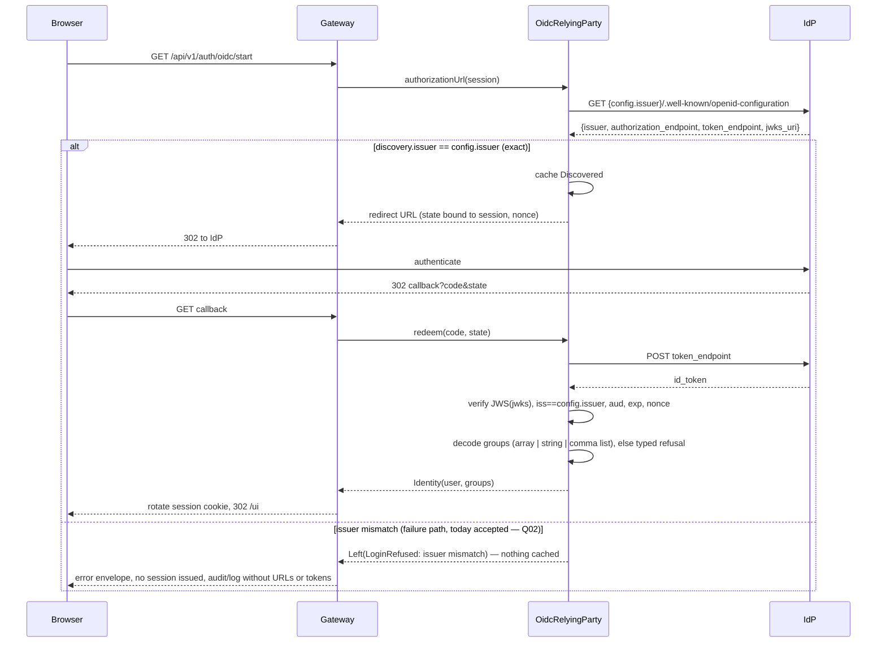
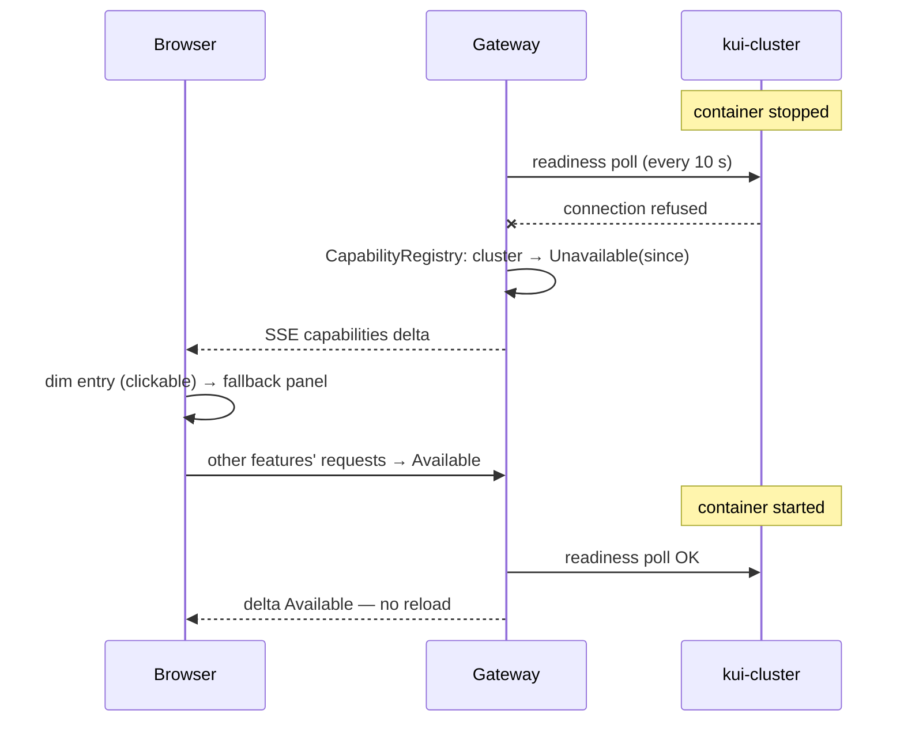
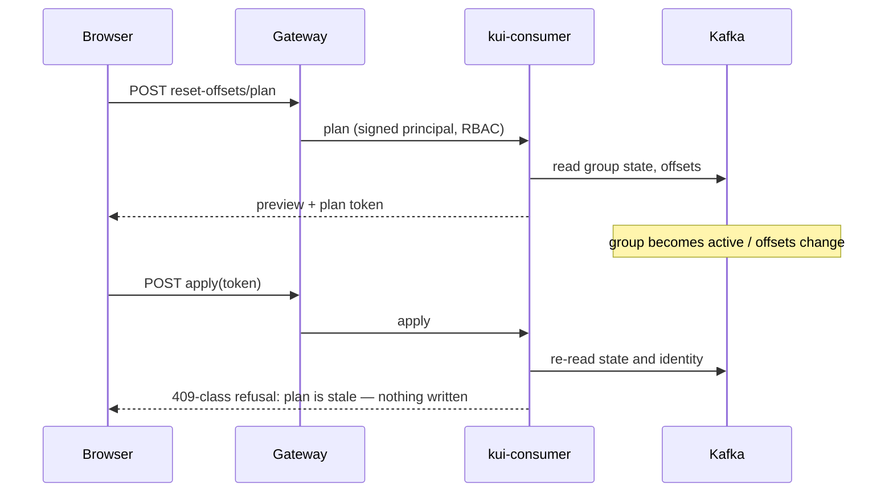

# KUI design: current state and next evolution

Date: 2026-10-24. Input type: existing-system redesign/evolution. Baseline: `main` at `e243692c`
(0.1.0 source release plus the quality-review commits). This document starts from the delivered
system, not a new design. Every recommendation traces to a driver in §7. It does not override
`ARCHITECTURE.md`. It reaffirms that document's decisions or names the driver for any change.

Labels: **[F]** fact with evidence path · **[A]** assumption · **[D]** decision (proposed unless
marked accepted) · **[Q]** open question. "verify" marks a third-party capability that has not
been checked here.

**Status 2026-10-25:** R0 (Q01, Q02/Q03, Q09, Q10, Q11) and R1 (Q04, Q05, Q06, Q08) are merged.
QUALITY_REVIEW.md "Phase 5" records the R1 evidence. Sections below keep the 2026-10-24 analysis.

## 1. Summary

- [F] KUI is a pre-1.0 Kafka web console. The same Mill modules ship in two backend shapes: a
  gateway plus nine routed domain services (`deployment/compose/docker-compose.yml`), or one
  all-in-one JVM (`apps/allinone`). A separate nginx/SolidJS frontend image serves both.
- [F] The architecture gates pass: `checkArchitecture` (289 modules, 10 rules), `lint:boundaries`,
  `bundle-shape`, `openApiCheck`, the coverage floors, and the distributed smoke test. The
  **trust-boundary and safety-net gates do not**: OIDC issuer binding (Q02), claim decoding (Q03),
  the dependency audit (Q01), browser E2E (Q10), and four flaky backend tests (Q04).
- [D] Direction: **harden in place**. Do not restructure. Land the review fixes and make the gates
  trustworthy, then resume feature work. The runner-up is to collapse to a modular monolith, kept as
  a deferred decision with a trigger (ADR-D08).
- [D] Style: keep **"one module graph, two deployment shapes"** (ARCHITECTURE.md §1/§11). Two
  drivers decide it: fault isolation is a product promise (README "Fails in sections") and a CI gate
  (`smoke.sh`). The all-in-one shape stays the default for small installations.
- [D] The next increment is risk-reducing and contains no new features: Q02/Q03 → Q11 → Q10 → Q01 →
  Q09, then Q04. Q05/Q06 refactors unlock only after their modules' browser tests are green.
- [F] Two gaps between documentation and delivery are recorded as open questions. No
  `kui-identity` image or container exists for the distributed shape, and `kui-security-service`
  is planned but not built.
- [D] This file's §10 is the current decision record. The `ADR-NNN` citations in ARCHITECTURE.md
  point to records that are not in this repository.

## 2. Calibration, facts, assumptions, open questions

**Calibration: class M** (a medium-rigor design pass). Reasons:

- [F] The code is large, with 1,232 Scala, 268 TSX and 211 TS files, but one team maintains it.
- [F] It has not been released at 1.0. Images are not published (`docs/operations/deployment.md`).
- [F] No SLA or multi-tenant SaaS exists. Today it runs as one gateway replica.

It is not class S. KUI performs destructive Kafka administration and handles credentials and
OIDC, so the security sections (§9 STRIDE, ADR-D02/D03) get class-L depth. It is not class L
overall, because no evidence of production scale, paying users, or compliance scope was found.

| # | Fact | Evidence |
| --- | --- | --- |
| F1 | 11 `services/*` trees. The gateway has no domain or infrastructure. 10 own a domain. | `services/`, ArchitectureDocumentSuite |
| F2 | 11 `KuiImage` targets: gateway, cluster, topic, message, consumer, schema, metrics, alerts, connect, ksql, allinone. **No identity image.** | `build.mill:3955-4068` |
| F3 | The distributed compose stack runs the gateway, 9 services and the frontend, with auth `disabled` (asserted by smoke) | `deployment/compose/docker-compose.yml`, `smoke.sh:1043` |
| F4 | The quickstart (including `--with-auth`) runs `kui-allinone` | `deployment/quickstart/docker-compose.quickstart.yml:453` |
| F5 | One gateway replica only. Sessions live in process memory. | `docs/operations/deployment.md` |
| F6 | Session creation budget: 30 new anonymous sessions per IP per minute, 600 per process. Login: 20/IP, 5/username per minute. | `docs/operations/gateway-authentication.md` |
| F7 | Playwright runs serially (`workers: 1`), with 128 selected cases | `frontend/playwright.config.ts:48-52`, QUALITY_REVIEW |
| F8 | Upstream HTTP budget per backend: 10 finite + 10 streaming sockets, at most 256 queued per pool | `DEPENDENCY_MATRIX.md` |
| F9 | Metadata lives in compacted Kafka topics `__kui_config` (one partition) and `__kui_files` (4 MiB cap), plus `__kui_audit`. There is no RDBMS. | ARCHITECTURE.md §10.1 |
| F10 | CI jobs: compile, style, architecture, security (pins + `pnpm audit --audit-level high`), generated, test (+coverage ratchet), frontend, browser (quickstart + Playwright), compose (`smoke.sh`). `pages.yml` builds the website without an audit. | `.github/workflows/ci.yml`, `pages.yml` |
| F11 | Review findings Q01-Q11. All resolved by 2026-10-25 (Q07 first, then R0 and R1). | `QUALITY_REVIEW.md` |
| F12 | The Prometheus query core is specified and approved. Later slices follow the capability map. | `SPEC-prometheus-query-core.md`, `CAPABILITY-MAP-…md` |

| # | Assumption | Decision it affects |
| --- | --- | --- |
| A1 | A typical installation has at most tens of concurrent operators (no usage data exists) | §7 capacity, ADR-D08 |
| A2 | Real IdPs publish a discovery `issuer` byte-equal to their documented issuer URL (verify per IdP) | ADR-D02 |
| A3 | The Q10 failures come from the harness creating sessions faster than F6 allows, not from a limiter defect | ADR-D04 |
| A4 | The Q04 failures are load- or timing-induced, not product races (unproven) | Roadmap R1 |
| A5 | Someone runs, or will run, the distributed shape in production (no adopter evidence) | ADR-D01, ADR-D08 |

| # | Open question | Decision it affects |
| --- | --- | --- |
| Q-a | Must an issuer that differs only by a trailing slash be rejected? Proposed: yes, exact match per OIDC Discovery §4.3. | ADR-D02 |
| Q-b | Which group-claim shapes must be supported: array, scalar, comma-separated, empty array? | ADR-D03 |
| Q-c | Is authentication supported in the distributed shape? F2/F3 show no packaged identity service. | ADR-D07, R2 |
| Q-d | Should a histogram clear or clamp its selection when data shrinks (Q11)? | MVP scope |
| Q-e | When is the upgrade window for Q01, given the Solid 2 prerelease? | ADR-D05 |
| Q-f | Is `kui-security-service` (ACLs and quotas) still on the roadmap? The README puts it out of scope. | Deferred list |
| Q-g | Which capability-map slices after `prometheus-query-core` are delivered? (not established here) | R3 |

## 3. Problem framing

**JTBD (operator):** when a Kafka-backed system misbehaves, see cluster, topic, consumer and record
state in one place and act safely. That restores flow without juggling five tools or running risky
CLI commands.

**JTBD (this increment, maintainer):** make "main is green" mean "safe to deploy beyond localhost",
so that feature work can resume without hidden trust-boundary or safety-net debt.

**5 whys (why is KUI not yet safe to expose beyond a local environment?)**

1. Authentication can be subverted or crash. The discovery issuer is not bound to configuration
   (Q02), and malformed group claims throw outside the typed result (Q03).
2. Why was this not caught? The OIDC suite has a single nonempty-list fixture, and no real IdP
   was exercised (CHANGELOG "Verification and known limits").
3. Why is the safety net not trusted to catch regressions? Browser E2E is red under the session
   limiter (Q10), and four backend tests are flaky (Q04).
4. Why does E2E hit the limiter? The 0.1.0 hardening added session budgets (F6). The serial harness
   creates sessions from one IP faster than 30 per minute (§7 math, A3).
5. Why did the cross-boundary effect go unowned? No current decision record exists (ADRs are
   missing, Q09). Each change was verified on its own side only.

**Root cause:** trust-boundary validation gaps, combined with a safety net and decision record
that drifted.

| Persona | What changes the design |
| --- | --- |
| On-call SRE | Fault isolation and partial responses. Must stay available while one integration is down. |
| Application developer | Record browse and filter, read-only clusters. Needs bounded memory and streaming. |
| Security / platform admin | OIDC issuer trust, RBAC, audit, secrets at rest. Owns the deployment-shape choice. |
| Maintainer / contributor | Gates must be deterministic. Docs must say what is delivered and what is planned. |

**Metrics.** Primary: consecutive full CI runs on `main` with every job green, target ≥ 5 [D]
(today 0, F10/Q10). Guardrails:

- backend and frontend test counts never decrease (4,913 and 2,144 at baseline)
- coverage floors hold (Scala lines 77% / branches 72%; frontend thresholds as committed)
- `pnpm audit --audit-level high` passes
- `smoke.sh` passes
- `bundle-shape` and `checkArchitecture` pass
- no OIDC token accepted under an issuer mismatch

**Riskiest assumptions, ranked:**

1. A2: exact issuer binding could lock out working providers.
2. Q01 upgrades are compatible with the Solid 2 prerelease.
3. A3: the Q10 failures come from the harness.
4. A4: the Q04 failures are load-induced.
5. A5: the distributed shape has users.

## 4. Ideas and evaluation

| ID | Direction |
| --- | --- |
| I1 | **Harden in place.** Land the review fixes, make the gates deterministic, change no structure. |
| I2 | **Modular monolith only.** All-in-one becomes the sole backend shape. Drop 10 service images, the distributed compose stack and `smoke.sh`. |
| I3 | **Integrate an edge auth proxy.** Delegate OIDC to an external proxy (e.g. oauth2-proxy, verify) and trust its headers. Remove the in-house relying party. |
| I4 | **Don't build: adopt an existing UI** (e.g. Kafbat UI, AKHQ, Redpanda Console; verify features and licences) and park KUI. |
| I5 | **Feature-forward.** Build `kui-security-service` (ACLs/quotas) and the remaining Prometheus slices before hardening. |
| I6 | **Buy/integrate observability.** Link to Grafana dashboards instead of building more in-app Prometheus history views. |

Scores are 1-5, higher is better (Cost 5 = cheapest, Risk 5 = safest).

| Criterion | I1 | I2 | I3 | I4 | I5 | I6 |
| --- | --- | --- | --- | --- | --- | --- |
| Driver fit (QAS-1..3) | 5 | 3 | 3 | 2 | 1 | 2 |
| User value now | 3 | 2 | 3 | 3 | 4 | 3 |
| Cost | 4 | 3 | 2 | 5 | 1 | 3 |
| Risk | 4 | 2 | 2 | 3 | 1 | 3 |
| Reversibility | 5 | 2 | 3 | 2 | 3 | 4 |
| Fit with recorded decisions | 5 | 2 | 2 | 1 | 4 | 3 |
| **Total** | **26** | **14** | **15** | **16** | **14** | **18** |

Justifications:

- **I1** targets Q01-Q11 directly. The fixes are small (S/M effort in QUALITY_REVIEW), each
  change is reversible, and ADR-005 is untouched.
- **I2** removes the smoke gate and the README fault-isolation promise. Process isolation is lost
  for good (§11.1). Partially one-way.
- **I3** still needs header-trust hardening. It changes the security model (ADR-015/019/020) and
  adds a hard operational dependency on the proxy. Whether the proxy fits needs verification.
- **I4** costs nothing to build but discards the product. Feature parity with the alternatives is
  unverified.
- **I5** builds on red gates. The security service is out of scope per the README (Q-f).
- **I6** is cheap and fits SREs who already run Grafana, but it does not address the drivers. It
  stays a candidate for R3.

**Primary: I1. Runner-up: I6.** It becomes the R3 option. I2 is kept as a deferred decision with
a trigger (ADR-D08), because if A5 proves false it removes significant cost.

## 5. Next-increment scope

| Item | Finding | Kano | MoSCoW |
| --- | --- | --- | --- |
| Bind discovery issuer to configured issuer | Q02 | Must-be | Must |
| Total, typed group-claim decoding | Q03 | Must-be | Must |
| Histogram survives removal of the selected bucket | Q11 | Must-be | Must |
| E2E harness respects the session budget and checks sign-in status | Q10 | Performance (gate trust) | Must |
| Dependency advisories: frontend high/critical, website markdown-it | Q01 | Must-be | Must |
| ARCHITECTURE.md delivered vs planned | Q09 | Performance (maintainer) | Must |
| Diagnose the four flaky backend tests | Q04 | Performance | Should |
| Shell search controller, browse-release duplication | Q05/Q06 | Indifferent (internal) | Could, after R1 |
| Shared OpenAPI driver | Q08 | Indifferent | Could |
| ACL/quota service, Helm chart, gateway HA, new Prometheus UI | — | Attractive | Won't (this increment) |

**Cheapest validating experiment** (riskiest assumption A2, needs no code): fetch
`/.well-known/openid-configuration` from each IdP the maintainers or adopters use (verify which
ones). Compare `issuer` byte for byte with the configured issuer, including the trailing slash.
Any mismatch decides Q-a before ADR-D02 ships.

For A3: rerun the full E2E against the harness fix. The pass criterion is zero `429` responses in
traces and an unchanged limiter configuration.

## 6. Domain model

**Event storming lite** (verbs are as delivered; ACL events are planned only):

| Actor | Command | Domain event | Policy / reaction |
| --- | --- | --- | --- |
| Admin | Register cluster | `ClusterProfileChanged` | Services refetch the profile (ETag) and rebuild serdes |
| Gateway poller | Probe readiness | `CapabilityDegraded` / `CapabilityRestored` | Shell dims or restores the feature (SSE) |
| Operator | Browse records | `BrowseStarted` → `BrowseDone(reason, cursor)` | Budget exhaustion ends the stream with `done` |
| Operator | Plan offset reset / purge / delete | `PlanIssued(token)` | Confirm re-checks state and identity |
| Operator | Confirm plan | `PlanApplied` / `PlanRejected(stale)` | Audit record |
| Alert evaluator | Evaluate rules | `AlertOpened` / `AlertResolved` | Feed count. Per-principal read marker. |
| Operator | Acknowledge | `AlertAcknowledged` | Durable in `__kui_config` |
| User | Log in (form/OIDC) | `SessionStarted` / `LoginRefused(reason)` | Rotate session, apply throttling |

**Subdomains:**

- **Core (differentiating):** Message Exploration (serde-aware browse, filters, masking). Safe
  Mutation (plan → token → confirm). Capability & Degradation (partial responses, fallback panels).
  Consumer lag and offset operations.
- **Supporting:** Cluster Registry and Topology (publisher of `ClusterProfile`), Topic Management,
  Alerting, Kafka Observability (metrics), and the adapters for Schema Registry, Connect and ksqlDB.
- **Generic (prefer libraries or integration):** Application Identity (OIDC/form via Nimbus),
  configuration loading, the metadata store envelope, telemetry.

**Context map:**

## 7. Drivers

**Top use cases:**

1. Browse and filter records.
2. Inspect consumer lag, then reset offsets with a preview.
3. Run topic CRUD with previewed destructive actions.
4. Watch cluster health and alerts.
5. Sign in with OIDC under RBAC.

**Quality-attribute scenarios, ranked:**

| # | QA | Source | Stimulus | Environment | Artifact | Response | Measure |
| --- | --- | --- | --- | --- | --- | --- | --- |
| QAS-1 | Security | Network attacker or misconfigured IdP | Discovery returns `issuer` ≠ `kui.auth.oidc.issuer` | Auth = oidc, normal operation | `OidcRelyingParty` | Refuse discovery. Cache nothing. Typed refusal. | 100% of mismatches refused, including trailing slash. No session issued. |
| QAS-2 | Reliability | IdP | Token with groups as scalar, comma list, empty array or malformed value | Login | `groupsOf` | Decode supported shapes. Malformed → `LoginRefused`. | 0 exceptions escape the effect. Each shape covered by a test. |
| QAS-3 | Availability | Ops | One domain service process stops | Distributed shape | Gateway, shell | Other features available. UI served. Self-heals on restart. | `smoke.sh` passes within its 90 s per-step ceiling |
| QAS-4 | Testability | CI | Full E2E run | 1 worker, auth fixture, F6 budgets | `frontend/e2e` harness | No rate-limit interference | 0 HTTP 429 in traces. ≥ 5 consecutive green full runs. |
| QAS-5 | Safety | Operator | Confirms a plan after state changed | Concurrent edits | Plan-token flows | Reject the stale plan | 100% of stale or mismatched identities rejected (existing tests) |

**Constraints:**

- [F] Scala 3.9 / JDK 21 images, Mill, SolidJS 2 prerelease, pnpm 11.25 pinned.
- [F] No RDBMS (ADR-042). Kafka is the metadata store.
- [F] Images are built locally, not published.
- [F] Generated files are not hand-edited.
- [F] Single gateway replica (F5).

**Back-of-envelope capacity.** Inputs are F6-F9 and A1. These are estimates, not benchmarks.

- **E2E session pressure (A3).** At most 30 new sessions per IP per minute. Assume each test uses
  ≥ 1 fresh browser context, so ≥ 1 anonymous session, plus an API request context.
  - 128 tests at ≥ 2 sessions each give ≥ 256 sessions.
  - At the observed focused speed (4 tests in 3.2 s, about 75 tests/min), the demand is about
    150 sessions/min, 5× the budget.
  - The serial run therefore exceeds the budget within the first minute. This is consistent
    with Q10 traces (15-17 × 429). [A] The per-test session count is inferred from the fixtures
    and needs verification.
- **Topic snapshot refresh.**
  - 10,000 topics / 200 per batch = 50 describe batches. At parallelism 4, that is ⌈50/4⌉ = 13
    rounds per 30 s cycle per cluster.
  - Group snapshot: 2,000 groups / 50 = 40 batches → 10 rounds.
  - [A] 10k topics and 2k groups are illustrative sizes. Round latency was not measured.
- **Gateway readiness polling.** 10 services × 1 probe / 10 s = 1 req/s per gateway. This is
  negligible.
- **Live tail fan-out.**
  - 20 operators (A1) × 20 events/s cap = 400 events/s to browsers.
  - Heartbeats: 20 streams / 15 s, about 1.3/s.
  - [Q] Whether gateway↔service streams draw on F8's 10-socket streaming budget was not verified.
    If they do, the 11th concurrent stream per backend waits.
- **Metadata store.** One partition of `__kui_config` serializes all writes, which is fine at
  human write rates. `__kui_files` records are ≤ 4 MiB, which requires `max.message.bytes` ≥ 4 MiB
  plus envelope overhead.

## 8. Options and trade-offs (architecture style)

| Option | Description |
| --- | --- |
| S1 | **Current: one module graph, two shapes.** Distributed (gateway + services) and all-in-one, built from the same modules. |
| S2 | **Modular monolith only.** The same hexagonal modules and gates, one process. |
| S3 | **Distributed only.** Drop all-in-one. |

| Attribute | S1 | S2 | S3 |
| --- | --- | --- | --- |
| Process fault isolation (QAS-3) | Yes (distributed) | No (§11.1) | Yes |
| Footprint and ops cost | Both paths maintained | Lowest | Highest. Quickstart becomes heavy. |
| Build and CI cost | 11 images + compose job | 1 image | 10 images |
| Code-path parity | Same objects (`InProcessServiceClient`) | n/a | n/a |
| Security surface | Signed principal JWS between processes | In-process principal | JWS everywhere |
| Change cost for a new service | Contract + image + compose + gateway edge | Module + wiring | Same as S1 minus all-in-one |
| Reversibility | High | Low (abandons a verified property) | Medium |

**Choice: S1 (reaffirms ADR-005).** Drivers: QAS-3, and the dev/quickstart footprint (persona
Application developer).

**Sensitivity points:**

1. Single gateway replica (F5). Availability of the whole console depends on that one process in
   both shapes.
2. Identity is not packaged for the distributed shape (F2, Q-c). Authenticated distributed
   deployments are unverified.
3. The readiness interval (10 s) and the p95 window drive recovery time (`smoke.sh` comments).
4. The upstream socket budget (F8) is per backend instance.

**Trade-off point:** fault isolation is bought with N+1 images and per-service configuration
mounts.

## 9. Architecture

### C4 L1 — system context

### C4 L2 — containers (distributed shape; all-in-one collapses gateway + services into one JVM)

### C4 L3 — Message Exploration (core context)

The layering is enforced by A1-A11 (`checkArchitecture`). Browse output is an SSE stream with one
terminal event, so memory is bounded by `PollBudget`.

### Sequence 1 — OIDC login with issuer validation (target after ADR-D02/D03)

### Sequence 2 — single service down (distributed)

### Sequence 3 — destructive operation with a stale plan

### Data per context

| Context | Owned data | Store | Notes |
| --- | --- | --- | --- |
| Cluster Registry | Cluster profiles (secrets AES-GCM) | `__kui_config` `cluster/<id>` | Single writer (ADR-036) |
| Identity | RBAC roles, password overrides | `__kui_config` `rbac/roles` | Fails closed on unreadable credentials |
| Gateway | Sessions, capability state | Memory | Lost on restart (F5) |
| Alerting | Events, acks, read markers | `__kui_config` `alerts/…`, `settings/…` | Bounded in-memory fallback without a store |
| Topic, Consumer, Metrics | Snapshots, series windows | Memory, rebuildable | 30 s refresh |
| Message | Serde and filter caches | Memory | Payloads never cached |
| Audit | Audit records | `__kui_audit` | Retention-based |

### Integration / API policy

These existing rules are reaffirmed:

- `/api/v1` is public and `/internal/v1` is internal. Changes within a major version are additive
  only, and consumers ignore unknown fields.
- Routes are derived from contracts. OpenAPI is generated and checked (`openApiCheck`), and browser
  types are generated from it.
- Service-to-service edges are a closed list (ADR-043).
- Partial responses use `Section`. A section failure never fails the response.
- Every stream ends with exactly one terminal SSE event.

### Security — STRIDE per trust boundary

| Boundary | S | T | R | I | D | E |
| --- | --- | --- | --- | --- | --- | --- |
| TB1 Browser ↔ frontend/gateway | Session cookie HttpOnly/Secure/SameSite, rotation | CSRF double-submit + `Sec-Fetch-Site` | Audit on mutations | No secrets to the frontend. Redacted config. | Login and session budgets (F6) | RBAC at the edge plus re-check in the service |
| TB2 Gateway ↔ services | HS256 JWS principal, `aud` per service, 60 s expiry | Request digest. Query string not covered (ADR-020). Relays re-decide. | Correlation id | Services private-network only | Bulkheads, circuit breakers | `X-Kui-*` stripped by prefix at the edge |
| TB3 KUI ↔ IdP | **Gap Q02**: discovery issuer not bound → D02 | JWKS signature verification | Login refusal logged | No token or URL in logs | Discovery cached; IdP outage blocks login only | **Gap Q03**: malformed groups throw → D03 |
| TB4 Services ↔ Kafka/SR/Connect/ksql/Prom | Typed Kafka auth per cluster | TLS with hostname verification | Audit records | Masking before delivery. `Secret[A]`. | Socket budgets (F8), redirects off | Strict URL policy. Connected-IP check. |
| TB5 KUI ↔ metadata store | Store credentials static | AES-GCM fields, version check | Audit topic | Operators must restrict ACLs on `__kui_*` | Serve last state, reject writes | n/a — no code is loaded from the store |
| TB6 Build/CI supply chain | Action SHA pins | Frozen lockfiles | Git history | Checkout discards credentials | n/a — build-time only | **Gap Q01**: vulnerable dev/runtime dependencies. Website audit not in CI. |

[F] No threat-model document exists (ARCHITECTURE.md §14). This table is the current substitute.

### SLIs/SLOs (proposed, [D]; no production measurements exist)

| SLI | SLO | Source |
| --- | --- | --- |
| UI served while one domain service is down | 100% of smoke runs | `smoke.sh` |
| Recovery after a service restarts, without reload | ≤ 90 s per smoke step | `smoke.sh` ceiling |
| OIDC mismatch acceptance | 0 | New `OidcRelyingPartySuite` cases |
| Full CI green on main | ≥ 5 consecutive runs | CI history |
| Partial-response correctness | Section failure never fails the response | Existing aggregation suites |

### Deployment / ops

- **Delivered:**
  - `kui-allinone` + `kui-frontend` (quickstart, small installs).
  - Gateway + 9 services + frontend (`deployment/compose`, auth disabled).
  - Secured and demo compose variants.
  - Probes `/health/live` and `/health/ready`. Non-root images with `ExitOnOutOfMemoryError`.
- **Not shipped:** Helm, published images, gateway HA, an identity image.

### Stack (one alternative per concern)

| Concern | Current | Alternative considered |
| --- | --- | --- |
| Backend runtime | Scala 3 + Cats Effect/fs2 + Tapir | ZIO + zio-http |
| Build | Mill 1.1.8 | sbt |
| Frontend | SolidJS 2 prerelease + Vite | Solid 1.x stable (lower prerelease risk for Q01) |
| Upstream HTTP | sttp + http4s Blaze (resolver-checked) | sttp Armeria FS2 backend (DEPENDENCY_MATRIX) |
| OIDC | Nimbus in-process RP | Edge auth proxy (I3; verify) |
| Metadata store | Compacted Kafka topics | Relational DB (rejected by ADR-042) |
| Telemetry | otel4s / OTel Java | Micrometer |
| Browser E2E | Playwright | Cypress |
| Packaging | Compose examples | Helm chart (deferred) |

## 10. Decision record (current)

This section is the current decision record. `ADR-001`…`ADR-049` cited in ARCHITECTURE.md are
historical, and their files are not in this repository. New decisions use `ADR-D<nn>`.
Door type: **one-way** (costly to reverse) or **two-way** (cheap to reverse).

### ADR-D01 Keep one module graph with two deployment shapes
- **Status:** Accepted (reaffirms ADR-005). **Door:** two-way while both are maintained. Dropping
  one is one-way.
- **Context:** QAS-3 and the footprint needs of the quickstart. S1-S3 in §8.
- **Decision:** Keep S1. All-in-one is the default for small installs. Distributed is for
  independent recovery.
- **Consequences:** Pay N+1 images and the compose job. Q-c (identity packaging) must be resolved
  before an authenticated distributed shape is advertised.

### ADR-D02 Bind OIDC discovery issuer exactly to configuration
- **Status:** Proposed; approved for implementation (branch `fix/q02-q03-oidc`, not yet verified
  here). **Door:** two-way.
- **Context:** Q02 and QAS-1. The OIDC Discovery 1.0 §4.3 issuer must equal the URL used for
  discovery.
- **Decision:** Before caching, compare `discovery.issuer == config.issuer` byte for byte, with no
  trailing-slash normalization (pending the Q-a experiment, §5). Validate the token `iss` against
  `config.issuer`. On mismatch return a typed refusal and cache nothing.
- **Consequences:** Providers whose configured issuer differs by a slash are refused. Operators
  must copy the exact issuer. Regression: discovery issuer B with configured A refuses, including
  a trailing-slash case.

### ADR-D03 Decode the groups claim totally
- **Status:** Proposed; approved (same branch). **Door:** two-way.
- **Context:** Q03 and QAS-2. Nimbus getters throw `ParseException` outside `catchNonFatal`.
- **Decision:** Read the raw claim value and match on its shape:
  - array of strings → set
  - string → split on commas, trim
  - empty array → no groups
  - any other shape → `LoginRefused`

  No exception reaches the effect.
- **Consequences:** Failed-login behavior changes from a defect to a typed refusal. Tests are
  added for each shape.

### ADR-D04 The E2E harness owns its session lifecycle; the product limiter is unchanged
- **Status:** Proposed; approved (branch `fix/q10-e2e-session-fixture`). **Door:** two-way.
- **Context:** Q10, QAS-4 and the §7 session math.
- **Decision:**
  - Fixtures check the sign-in status and refuse non-2xx before protected reads.
  - Sessions are reused per worker and principal instead of minted per test.
  - Limiter budgets and the limiter test stay as they are.
  - No assertion is weakened.
- **Consequences:** Removes 429 interference. A future parallel-worker increase must recompute
  against F6.

### ADR-D05 Dependency remediation keeps the audit gate blocking
- **Status:** Proposed; approved (branch `fix/q01-dependency-advisories`). **Door:** two-way.
- **Context:** Q01 and TB6. Development tools run in the trusted build (ci.yml comment).
- **Decision:**
  - Upgrade to the patched lines the audit reports: Seroval ≥ 1.6.1, Storybook ≥ 10.6.2, the
    other high-severity packages, and markdown-it 15.0.3.
  - Regenerate the lockfiles.
  - Keep `pnpm audit --audit-level high` blocking.
  - Add a website audit step to CI as a separate, approved CI change.
- **Consequences:** Compatibility risk with the Solid 2 prerelease. Requires a full build,
  Storybook and E2E run after the upgrade.

### ADR-D06 Histogram selection must be total over data changes
- **Status:** Proposed; approved (branch `fix/q11-histogram-selection`). The clear-versus-clamp
  choice is Q-d. **Door:** two-way.
- **Context:** Q11. Tooltip effects dereference a removed bucket.
- **Decision:** Guard tooltip reads. When the selected index is out of range, apply the chosen
  policy. Recommended: clear, because a clamped selection would point at a different bucket
  without the user choosing it.
- **Consequences:** Replace the characterization test that pins the crash with the desired
  behavior.

### ADR-D07 Documentation separates delivered from planned
- **Status:** Accepted (applied with this document). **Door:** two-way.
- **Context:** Q09. Missing ADR and DECISIONS files, a removed E2E suite, and an unbuilt security
  service.
- **Decision:** ARCHITECTURE.md marks planned items explicitly and names the gates that verify
  delivered claims. This file holds current decisions.
- **Consequences:** Readers have one place for current decisions. Proposed fitness function F-7
  (§11).

### ADR-D08 Deferred: collapse to a modular monolith (S2)
- **Status:** Deferred. **Door:** one-way.
- **Trigger:** A5 is shown false. For example, no known distributed adopter by 1.0, or the cost of
  the distributed shape blocks a release.
- **Decision when triggered:** Re-run §8 with adopter evidence.

### Other deferred decisions

| Decision | Trigger |
| --- | --- |
| Gateway HA / shared session store | A requirement for more than one gateway replica or zero-downtime gateway restarts |
| Authenticated distributed shape (identity image or in-gateway composition) (Q-c) | First request for auth in the distributed deployment, or before 1.0 |
| `kui-security-service` (ACLs/quotas) (Q-f) | Product scope change. README currently excludes it. |
| Helm chart / published images | 1.0 release, or the first Kubernetes adopter |
| Lucene search (existing ADR-038 trigger) | p95 > 50 ms on ≥ 50k names |
| Async internal events (`kui.internal.events`) | A cross-service consistency need that the snapshot-plus-poll model cannot meet |
| Grafana link-out instead of in-app history (I6) | R3 planning, if remaining capability-map slices are not yet delivered (Q-g) |

## 11. Pre-mortem, risks, fitness functions

**Pre-mortem: "It is 2027-04 and 1.0 slipped or shipped unsafe" — because:**

- Exact issuer binding broke a real IdP and was relaxed hastily.
- The Q01 upgrades broke Solid 2 and the audit gate was disabled.
- E2E stayed flaky and the team stopped reading it.
- The distributed shape shipped without auth.
- Docs drifted again.

| # | Risk | Likelihood | Impact | Mitigation | Owner gate |
| --- | --- | --- | --- | --- | --- |
| R-1 | Issuer binding rejects a legitimate IdP (A2) | M | H | Run the §5 experiment first. Clear error naming the expected and actual issuer, without the URL in logs. | OIDC suite |
| R-2 | Dependency upgrades break the prerelease framework (Q01) | M | H | Separate branch. Full frontend gates. Alternative: Solid 1.x evaluation. | `pnpm audit`, build, E2E |
| R-3 | Safety net stays untrusted (Q04/Q10) | M | H | ADR-D04. Diagnose Q04 under controlled load. Never raise timeouts to hide failures. | CI history |
| R-4 | Authenticated distributed shape advertised but not delivered (Q-c) | M | M | Doc marking (D07). Decide before 1.0. | ArchitectureDocumentSuite (extend) |
| R-5 | Single gateway is a total-outage point | L | M | Document it (done). Deferred HA trigger. | — |
| R-6 | Doc drift returns | M | L | F-7 below | — |

**Fitness functions:**

| ID | Property | Mechanism | Status |
| --- | --- | --- | --- |
| F-1 | Layering A1-A11 | `./mill checkArchitecture` | [F] in CI |
| F-2 | Frontend package boundaries | `pnpm lint:boundaries` | [F] in CI |
| F-3 | Features lazily loaded (A7) | `pnpm bundle-shape` | [F] in CI |
| F-4 | Contracts match code | `./mill __.openApiCheck`, `docs.errorCodes --check`, `frontend.apiConstants --check`, generated-types step | [F] in CI |
| F-5 | Coverage ratchet | `scripts/check-coverage.sh` (77/72 floors) and frontend thresholds | [F] in CI |
| F-6 | Dependency risk | `pnpm audit --audit-level high`, `check-action-pins.sh` | [F] in CI. Website audit [D] to add. |
| F-7 | ARCHITECTURE.md §3 vs tree | `ArchitectureDocumentSuite` | [F]. Extending it to the §1/§2 catalog vs `deployment/compose` and `build.mill` images is [D], a separate change. |
| F-8 | Fault isolation | `deployment/compose/smoke.sh` in the `compose` job | [F] in CI |
| F-9 | Issuer binding and claim totality | New `OidcRelyingPartySuite` cases | [F] in CI (R0) |
| F-10 | No limiter interference in E2E | Fixture status check, 0 × 429 | [F] in CI (R0) |

## 12. Roadmap (risk-reducing increments; the walking skeleton already exists)

| Milestone | Content | Retires | Exit criteria |
| --- | --- | --- | --- |
| R0 Review fixes (done) | ADR-D02/D03 (Q02/Q03), D06 (Q11), D04 (Q10), D05 (Q01), D07 (Q09) | R-1 (after experiment), R-3 (partly), TB3/TB6 gaps | New regression tests fail before and pass after. Audit gate passes. Docs corrected. |
| R1 Trustworthy safety net (merged; CI streak pending) | Diagnose Q04 under isolated resources. Then the Q05/Q06 refactors. | R-3 | ≥ 5 consecutive green full CI runs. Test counts not decreasing. |
| R2 Auth in every shape | Resolve Q-c (identity image or gateway composition). Real-IdP compatibility check (verify which containerized IdP CI can run). Threat-model doc from §9. | R-4 | Smoke variant with `authType != disabled` passes |
| R3 Observability slices | Confirm Q-g. Finish the capability map, or choose I6 link-out. | — | Per the capability map's own criteria |
| R4 1.0 readiness | Published images, revisit deferred HA/Helm triggers, raise coverage floors (review notices) | R-5 | Release checklist |

## 13. Glossary

| Term | Meaning |
| --- | --- |
| All-in-one | `apps/allinone`: gateway and every service in one JVM, using in-process contract clients |
| Distributed shape | Gateway plus one container per domain service (`deployment/compose`) |
| Capability | `(service, cluster)` availability state: Available, Degraded, Unavailable, NotConfigured |
| Section | Partial-response envelope: Ok, Stale, Unavailable, Forbidden, NotConfigured |
| ClusterProfile | Published language of the Cluster Registry: endpoints, security, serdes, limits |
| Plan token | Signed token from a preview step that a destructive confirm must present and re-validate |
| Signed principal | `X-Kui-Principal` HS256 JWS from the gateway to services, bound to the request digest |
| Metadata store | Compacted Kafka topics `__kui_config` and `__kui_files`, plus `__kui_audit` |
| Discovery issuer | The `issuer` field of an OIDC provider's discovery document |
| Door type | Reversibility of a decision: one-way (costly) or two-way (cheap) |
| Q01-Q11 | Findings in `QUALITY_REVIEW.md` |
